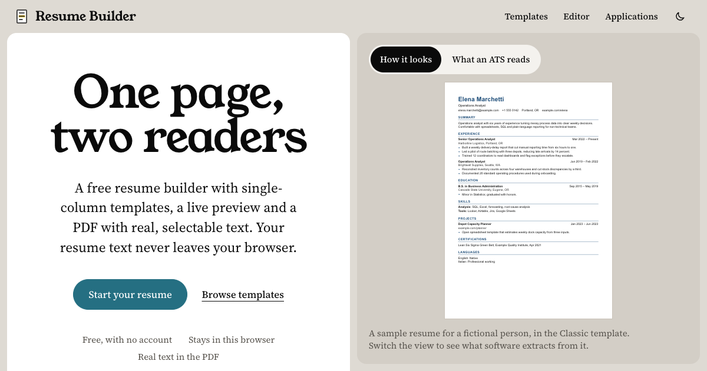

# Resume Builder

A free, private, ATS-friendly resume builder. Pick a single-column template, fill in your details, check how an applicant tracking system would read the result, and save it as a PDF. No account, no database, no AI writing.

**Live site:** <https://resume-builder-project.vercel.app>

## What it is

Resume Builder is for people who want a resume that reads cleanly in an applicant tracking system (ATS) and who would rather keep their data on their own device. Everything you type stays in your browser. The app focuses on three things: provable privacy, verifiable ATS-safe output, and rule-based tailoring of a resume to each job.

## Features

### Templates

- 12 single-column templates: classic, modern, compact, elegant, bold, minimal, executive, academic, technical, graduate, softline and ledger.
- A gallery with live thumbnails rendered from sample data (a fictional person).

### Editor

- Nine section types: contact, summary, experience, education, skills, projects, certifications, languages and custom.
- Reorder or hide sections.
- Design controls for accent colour, font, size, line spacing, margins and date format.
- A4 or US Letter pages, a live preview, and light and dark themes.

### Checks

- **ATS checklist** with a page-length estimate.
- **Plain-text preview** of what a parser would extract.
- **Parse simulator** that reads the text layer into fields and flags where parsing fails. Each finding jumps to its input.
- **Bullet coach** that flags weak openers, missing numbers, tense, repeated verbs, passive voice and filler.
- **Fit to one page** finds the smallest line-spacing, margin or font-size change that fits one page, with Apply and Undo. When style changes are not enough, it lists where to cut.

### Job tailoring

- Paste a job posting to see which key terms already appear in your resume, which are missing, and which sections hold them.
- It uses plain rules, not AI, and shows counts and term lists, not a score.
- Add a missing term to Skills, or jump to the Summary or Experience to work it into a sentence.

### Versions

- Keep one resume per role. Each version has its own content, design and job posting.
- Compare two versions to see lines added and removed per section, and which job-posting terms each version covers.

### Cover letters

- A template-driven cover letter for each version. Your name and contact details come from the resume, and talking points come from job match.
- It uses the same print pipeline as the resume.

### Applications tracker

- Track where each version went: company, role, status, dates, link and notes.
- Each application keeps its own copy of the job posting, so later edits do not change it.

### Export and sharing

- **Print / Save as PDF** with a real, selectable text layer.
- **JSON export and import** for one version or all of them. Imports are validated and migrated, and a bad file changes nothing.
- **Encrypted backup**: optionally protect an export with a passphrase (PBKDF2-SHA-256 and AES-256-GCM, in your browser). There is no recovery for a lost passphrase.
- **Backup reminders** appear when changes older than 7 days are not in a backup.
- **Redacted share copy** removes contact and identifying details so you can ask for feedback in public. It can be saved as PNG images.

## ATS-safe by design

Every template uses the same document structure: the name is an `h1`, sections are `h2`, entries are `h3`, and lists are real `ul` and `li` elements. There are no tables, columns, images or icons in the resume body.

Two styling choices are avoided because they scrambled the PDF text layer in testing: `position: relative` on text blocks and large `letter-spacing`.

## Privacy

- Resumes, versions, applications, job postings and backup-reminder state are stored in your browser's `localStorage`. Nothing is uploaded, and there is no server-side handling of resume data.
- If storage is blocked, the app still works and warns you that changes will not persist. Clearing site data removes everything, so export a backup if you want to keep it.
- The app makes no third-party network calls. Its own fonts are self-hosted.
- The site uses Vercel Web Analytics to count page views. It does not read what you type or the contents of your resume.
- Security headers are set (no framing, a strict referrer policy, and camera, microphone and geolocation disabled). A Content Security Policy runs in report-only mode.

## Accessibility

The app aims for WCAG 2.2 AA, with a skip link, keyboard-operable dialogs with managed focus, and support for light and dark themes.

## Built with

Next.js (App Router), React, TypeScript and Tailwind CSS.

## Not planned

These would need a backend or would send resume data off your device, so they are out of scope: AI writing, accounts, cross-device sync and share links. There is also no single ATS or match score, because checks stay explainable.

## Maintainer

Adrian Nads Marcelo
